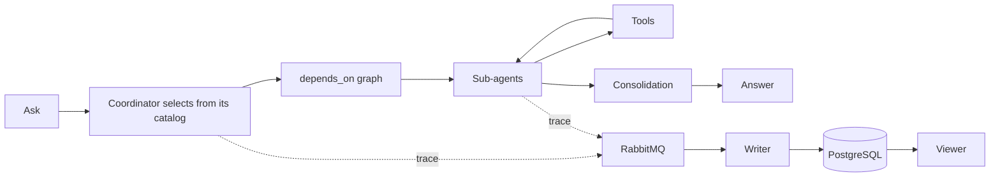

# badk

Stateless, budget-bounded, cache-aligned multi-agent development kit.

## How badk works

You give badk one ask. A coordinator agent runs it on one of two paths. On the classical path (no `flow` in the agent file), the model decides: the coordinator picks sub-agents from its catalog, they run in the order of their `depends_on` graph, call tools, and the coordinator joins their results into one answer. On the flow path (a `flow` in the frontmatter), the file fixes the steps (tools, sub-agents, `select`) and their order, and the model is called only where a step needs it (see [Agent types](#agent-types)). Each step is a trace record. RabbitMQ carries the records to a writer. The writer saves them in PostgreSQL. The viewer shows them.



## Prerequisites
- Docker Desktop (Compose v2)
- uv (https://docs.astral.sh/uv/)
- A model behind the `LLM_*` settings: the Anthropic API (key), any OpenAI-compatible API such as DeepSeek or Ollama (set `OLLAMA_CONTEXT_LENGTH` to 8192 or more on the server), or a Claude Code login (`claude_cli`).

## Start and stop
```bash norun
cp .env.example .env        # substitute your own values
./start.sh                  # app + PostgreSQL + RabbitMQ (--build for a clean rebuild)
./stop.sh                   # --clean also drops volumes and images
```

Load `.env` into your shell (the commands below use `$APP_PORT`), install the dependencies and check that the stack is up:

```bash norun
set -a; . ./.env; set +a
```

```bash
uv sync
curl -fsS http://localhost:$APP_PORT/health
```

## The agent file

An agent is one Markdown file in `agents/`. The frontmatter holds the fields. The body is the role text.

| Field | Meaning |
|---|---|
| `name` | Agent name. It matches the file name. |
| `provider` | Model provider: `openai`, `anthropic`, `claude_cli` or `fake`. |
| `model` | Model name for the provider. |
| `context_window` | Token size of the model window. |
| `compression_threshold` | Share of the window that starts compression. |
| `token_budget` | Maximum tokens for one try. |
| `time_budget_sec` | Maximum seconds for one try. |
| `max_tries` | Maximum tries. |
| `permissions` | Tool names the agent may call. |
| `workspace` | Folders the agent tools may read and write. |
| `agents` | Sub-agents a coordinator may select. |
| `always` | Sub-agents a coordinator always runs. |
| `use_when` | One line that tells the coordinator when to pick this agent. |
| `depends_on` | Sub-agents that must finish first. |
| `selection_schema` | JSON schema for the coordinator selection reply. |
| `output_schema` | JSON schema for the final result. |
| `max_parallel` | Maximum sub-agents that run at the same time. A sub-agent may set it only with a `flow`. |
| `flow` | Optional list of steps (`tool`, `agent` or `select`, with `after` and `on_error`) the agent runs in a fixed order. |
| `final` | With a `flow`: `model` (default) writes the answer, `none` returns the step results. |

## Agent types

An agent file with no `flow` is classical: the model decides what to do. An agent file with a `flow` runs the steps the frontmatter lists, in a fixed order. You choose per agent file. Every block below is the frontmatter of a real file; the role text and the budget note are in the file. The same four types, with a working file for a new project, are in step "Choose an agent type" of the project `README.md` that `scripts/init.sh` writes.

### Pure agentic (classical)

The model decides. The coordinator picks sub-agents from `agents` (and always runs those in `always`), the sub-agents call the tools in their `permissions`, and the coordinator writes the answer. This is `examples/agents/coordinator.md`:

```yaml
---
name: coordinator
provider: $LLM_PROVIDER
model: $LLM_MODEL
context_window: 8192
compression_threshold: 0.75
token_budget: 6000
time_budget_sec: 900  # must exceed sub-a 120x2 + sub-b 120x2 = 480 plus PROVIDER_TIMEOUT_SEC 120 (consolidation reserve) = 600 (WF-11); the 300 s left are for selection (a cold model load, one retry)
max_tries: 2
max_parallel: 2
permissions: []
agents: [sub-a, sub-b]
always: [sub-b]
workspace: ["."]
output_schema:
  type: object
  additionalProperties: true
---
```

### Deterministic workflow (`flow`, `final: none`)

The file lists steps. A tool step runs one tool with fixed `args`. With `final: none` no model is called at all: the run returns the step results. This is `examples/flows/agents/coordinator-pipeline.md`:

```yaml
---
name: coordinator-pipeline
provider: $LLM_PROVIDER
model: $LLM_MODEL
context_window: 8192
token_budget: 6000
time_budget_sec: 300
max_tries: 1
permissions: [echo_text]
workspace: ["."]
final: none
flow:
  - {id: t1, tool: echo_text, args: {text: "{{ask}}"}, after: []}
  - {id: t2, tool: echo_text, args: {text: "t1 said {{t1.body.stdout}}"}, after: [t1]}
---
```

Each step is a mapping with these keys:

| Key | Meaning |
|---|---|
| `id` | Step name, unique in the flow: a lowercase letter, then lowercase letters, digits or `_`. `ask`, `run_id`, `task_id` and `coordinator` are reserved. |
| `tool` | A tool step: the tool name. It must be in the agent `permissions`. |
| `args` | Tool arguments (tool steps only). A string value may hold placeholders. |
| `agent` | An agent step: the name of a sub-agent to run. |
| `select` | A `select` step: a list of sub-agents; the model picks from them at run time. |
| `after` | Ids of the steps that must end first. Default: the previous step (the first step: none). Steps with no path between them run in parallel, up to `max_parallel`. |
| `on_error` | `skip` (default): skip this step when a parent ended in error or was skipped. `run`: run anyway and read the parent's result. |

A step has exactly one of `tool`, `agent` and `select`. A flow has no `when`, no `if` and no loops. To branch, use a `select` step, a sub-agent prompt, or a tool that decides.

Placeholders in `args`:
- `{{ask}}` is the ask text.
- `{{run_id}}` is the badk run id. `{{task_id}}` is the key of this step, for example `t1` (in a nested flow: `sub-x/t1`). Use them to link rows that a tool writes back to the run.
- `` reads the result of an earlier step, for example `{{t1.body.stdout}}`. The step must be an ancestor through `after`. A path that is not in the result fails the step.
- A string that is exactly one placeholder takes the JSON type of the value (number, list, object, null). A placeholder inside longer text is replaced by its text.

Every tool step gives an envelope with the keys `status` (`ok` or `error`), `error_code`, `message` and `body`. For a `bash` tool the `body` is `{exit_code, stdout, stderr, truncated}`. `{{t1.status}}` reads the envelope; `{{t1}}` is all of it.

The frontmatter of an agent file is limited to 500 tokens, `flow` included. Keep a flow short; put long logic in a tool.

### Combinations: agent and `select` steps

A flow can mix tool steps with `agent` steps (run one named sub-agent) and `select` steps (the model picks sub-agents from a list). With `final: model` (the default) the model writes the answer from the step results; with `final: none` the step results are the answer. This is `examples/flows/agents/coordinator-mixed.md`:

```yaml
---
name: coordinator-mixed
provider: $LLM_PROVIDER
model: $LLM_MODEL
context_window: 8192
token_budget: 6000
time_budget_sec: 2000
max_tries: 1
permissions: [echo_text]
workspace: ["."]
final: model
flow:
  - {id: t1, tool: echo_text, args: {text: "{{ask}}"}, after: []}
  - {id: p, select: [sub-plain, sub-nested], after: [t1]}
---
```

A sub-agent that a step runs is a classical file (`examples/flows/agents/sub-plain.md`) or a file with its own `flow`.

### Sub-agent flows and nesting

A sub-agent can have a `flow` too. A step of a flow can run it, so flows nest. The depth limit is 4: at most 4 agents with a `flow` on one path, and a cycle is refused at load. A sub-agent with a `flow` may set `max_parallel`. This is `examples/flows/agents/sub-nested.md`:

```yaml
---
name: sub-nested
provider: $LLM_PROVIDER
model: $LLM_MODEL
context_window: 4096
token_budget: 3000
time_budget_sec: 600
max_tries: 1
permissions: [echo_text]
workspace: ["."]
use_when: Echo the task, then answer it with sub-plain.
final: none
flow:
  - {id: t1, tool: echo_text, args: {text: "{{ask}}"}, after: []}
  - {id: a1, agent: sub-plain, after: [t1]}
---
```

`badk check` validates every flow at load: step keys, `after` cycles, placeholders, permissions, depth and the time budgets. A coordinator with a `flow` has no `agents` or `always`. Steps run one at a time unless the file sets `max_parallel` (default 1); then steps with no `after` path between them run in parallel, up to that number. Run it with its slash name from `examples/flows`, with a copy of `.env` there (`.env` is git-ignored): `badk run "/pipeline hello"` runs `coordinator-pipeline`.

## Add an agent
Copy `agents/_template.md` to `agents/sub-<name>.md`. Edit `name`, `use_when` and `workspace`. Add the name to `agents` and `always` in `agents/coordinator.md`. Use `depends_on` to run one agent after another. The coordinator `time_budget_sec` must be larger than the longest `depends_on` chain.

## Tools: where they live and how an agent gets them

A tool is a file `tools/<name>.md` in the project root (the parent of the agents folder). A `python` tool also has a file `tools/<name>.py`. The tool types are `bash`, `python` and `http`.

badk has no runtime tool registry and generates no tools. The `tools/` folder is the registry: one `<name>.md` per tool.

An agent gets a tool only when its `permissions` lists the tool name. The default is deny.

Start validates every tool file. A bad file stops the start.

A `permissions` name with no tool file is refused at start. A name that starts with `_` (a template) is refused too. This holds for `badk.run`, `badk run` and `badk serve`. The error is `VALIDATION_ERROR`. It names the agent file and the name.

A tool child process gets a scrubbed environment: the `ENV_ALLOW` keys (in `src/badk/tools/execute.py`), the keys its own tool file lists in `env:`, and `BADK_RUN_ID` and `BADK_TASK_ID` (the run id and the task key, as `{{run_id}}` and `{{task_id}}` in a flow). No other key from `.env` reaches a tool. badk's path guard refuses `*.env` paths, so no agent can read `.env` through a tool argument.

### Give a tool a secret (`env:`)

A tool gets a key from `.env` only when its tool file lists the key name in `env:`. The model never sees the value.

1. Put the key in the project `.env`. Substitute your own value; it must have 8 or more characters.

   ```bash norun
   WEATHER_API_KEY=<your key>
   ```

2. List the key in the tool file. A `bash` or `python` tool gets it as an environment variable:

   ```yaml
   ---
   name: weather
   type: bash
   description: Weather for one city.
   command: tools/scripts/weather.sh {{city}}
   env: [WEATHER_API_KEY]
   args:
     type: object
     properties:
       city: {type: string}
     required: [city]
     additionalProperties: false
   ---
   ```

   The script reads `$WEATHER_API_KEY`. A `python` tool reads `os.environ["WEATHER_API_KEY"]`.

   An `http` tool writes `{{env.NAME}}` in a header value:

   ```yaml
   ---
   name: weather_http
   type: http
   description: Weather for one city.
   env: [WEATHER_API_KEY]
   request:
     method: GET
     url: https://api.example.com/weather/{{city}}
     headers: {Authorization: "Bearer {{env.WEATHER_API_KEY}}"}
   args:
     type: object
     properties:
       city: {type: string}
     required: [city]
     additionalProperties: false
   ---
   ```

3. Give the tool to an agent (`permissions: [weather]`) and run.

Rules:

| Rule | What badk does |
|---|---|
| Key name | Capital letters, digits and `_`, a letter first. It may not start with `BADK_`. A key that every tool child gets already (`PATH`, `HOME`, `LANG`, ...) is refused at start. |
| Source | `.env` of the project. A value in the process environment wins. |
| Start check | `badk.run`, `badk run`, `badk serve` and `badk check` stop with `VALIDATION_ERROR` when a permitted tool's key is missing, empty or shorter than 8 characters. The error names the tool file and the key. No run starts. |
| `{{env.NAME}}` | Only in an `http` header value, and only for a name in `env:`. In the url, the body or a header name, the tool file is refused at load. A model argument never fills it. |
| Fixed host | An `http` tool that uses `{{env.NAME}}` needs a fixed `http(s)://host` in `url` (a placeholder in the path is fine), and it follows no redirect: a `3xx` reply is an error. So the value goes to that host only. |
| Masking | Every declared value becomes `***` in every tool result and tool error, of every tool; also the first part of a value that the output size cap leaves at the end. The value never reaches the model, the trace, the database or the viewer. An encoded copy (URL- or JSON-escaped) is not masked. |
| Other tools | A tool that does not list the key does not get it. |
| Cloud mode | Add `- WEATHER_API_KEY` to the `runtime` service `environment:` in `docker-compose.yml`. |
| Limit | A `python` tool runs with your user rights and no sandbox. It can read `.env` itself. badk only makes sure that it gives a key to no tool that did not list it. The `settings=` overrides of `badk.run` do not set tool keys. |

The standard toolset keeps its own secrets in `tools/secrets.env` (see [Secrets: two places](#secrets-two-places)). MCP servers are reached through tool files of `type: mcp` (see [MCP servers](#mcp-servers)).

## Add a tool and give it to an agent

Copy the bash template to `tools/demo_echo.md`. Change the name.

```bash norun
sed 's/^name: .*/name: demo_echo/' tools/_template_bash.md > tools/demo_echo.md
```

Put the name in the `permissions` of the agent that may call it:

```yaml
permissions: [demo_echo]
```

The agent then calls `demo_echo` with `{"text": "..."}`. Each call is a `tool` record in the trace.

## Start a new project with init.sh (step by step)

`scripts/init.sh` makes a folder a badk project. It installs the `badk` command, adds `agents/`, `tools/` (templates and the standard toolset), `.env`, `tools/secrets.env`, a project `README.md` and `TOOLSET.md`, then runs `badk check`.

Run it again in an existing project to get new standard tools and the new README. It adds only what is missing and keeps your agents, tools, `.env` and secrets. Only `README.md` and `TOOLSET.md` are replaced; a changed one is saved first as `README.md.bak` / `TOOLSET.md.bak`. To get a new copy of a standard tool, delete its files and run init again.

1. Start the stack in the clone (once):

   ```bash norun
   ./start.sh
   ```

2. Make the project folder and run the script in it. Substitute your own path:

   ```bash norun
   mkdir ~/my-badk-app && cd ~/my-badk-app
   <badk clone>/scripts/init.sh
   ```

   The script does 5 steps:

   | Step | What it does |
   |---|---|
   | 1/5 | `uv tool install --editable "<clone>[toolkit]"`: the `badk` command runs your clone (a change in the clone needs no reinstall), with the toolset libraries (ddgs, html2text). |
   | 2/5 | A new project only: `agents/coordinator.md`, `agents/sub-demo.md`, `agents/_template.md` and `tools/demo_echo.md`. An existing `agents/` is not changed. |
   | 3/5 | `tools/`: the `_template_*` files and the standard toolset, each one only when it is missing. |
   | 4/5 | `.env` (a copy of the clone `.env`, else `.env.example`, mode 600) and `tools/secrets.env` (mode 600, added to `.gitignore`), each only when missing. `README.md` and `TOOLSET.md`: replaced. |
   | 5/5 | `badk check`. Exit 1 when a line is `FAIL`. |

   If `badk` is not found later, run `uv tool update-shell` and open a new shell.

3. Set the model in the project `.env`. Substitute your own values:

   | Provider | `LLM_PROVIDER` | `LLM_MODEL` (example) | `LLM_BASE_URL` | `LLM_API_KEY` |
   |---|---|---|---|---|
   | Anthropic API | `anthropic` | `claude-haiku-5-5` | not used | your API key |
   | DeepSeek API | `openai` | `deepseek-chat` | `https://api.deepseek.com` | your API key |
   | Ollama (local) | `openai` | an Ollama model tag | `http://127.0.0.1:11434` | empty |
   | Claude Code login | `claude_cli` | `haiku` | not used | empty |

   `anthropic` calls the Messages API with the key. There is no Claude Code harness and there are no Claude Code tools: only the project `tools/` run. `claude_cli` runs `claude -p` with your Claude Code login. Keep `PROVIDER_TIMEOUT_SEC` less than the coordinator `time_budget_sec` (600).

4. Check the project. Run this after each change to `.env`, `agents/` or `tools/`:

   ```bash norun
   badk check
   ```

   | Line | What it checks |
   |---|---|
   | `config` | `.env` loads and its values are valid. A FAIL stops the other lines. |
   | `agents` | Agent and tool files are valid, each `permissions` name has a tool file, the time budgets fit. Shows the coordinator provider and model. |
   | `provider` | `anthropic` has `LLM_API_KEY`; `claude_cli` finds `claude` on PATH. No model call. |
   | `broker+viewer` | RabbitMQ accepts a login; the viewer `/health` answers. |
   | `database` | The viewer reads the run list from PostgreSQL. |

5. Run an ask:

   ```bash norun
   badk run "say hello" --headless
   ```

   stderr shows `run_id: <id>` and the progress; stdout is the answer only. Exit code 0 = completed, 3 = the run failed, 1 or 2 = the run did not start. `progress/<run_id>.log` keeps the progress lines.

6. Read the trace at `http://localhost:$APP_PORT/runs/<run_id>`. Each model call is an `llm` record with `tokens_in`, `tokens_out` and `latency_ms`. Each tool call is a `tool` record. To compare providers, run the same ask with each one: change only `LLM_PROVIDER`, `LLM_MODEL` and `LLM_API_KEY`, then compare the answers, tokens and times.

7. Add your own tools and agents (see [Add a tool](#add-a-tool-and-give-it-to-an-agent) and [Add an agent](#add-an-agent)), then remove `sub-demo` and `demo_echo`.

## The standard toolset

badk ships these tools in `examples/toolkit/tools/`. `scripts/init.sh` copies them into the project `tools/`. They use widely used open-source libraries: [ddgs](https://pypi.org/project/ddgs/), [html2text](https://pypi.org/project/html2text/), and httpx. The `toolkit` extra of badk installs ddgs and html2text. The official [mcp](https://pypi.org/project/mcp/) SDK is a core dependency of badk.

| Tool | What it does | Config |
|---|---|---|
| `web_search` | Search the web with DuckDuckGo (no key); if DuckDuckGo blocks, ddgs's other keyless engines answer. Returns title, url and snippet. | none |
| `web_fetch` | Get a public page as markdown text. It uses badk's http executor, so private and loopback addresses are refused, also after a redirect. | none |
| `mcp_list` | List the tools of an MCP server (name, description, inputSchema). A `type: mcp` tool, `action: list`. | `tools/mcp.json` |
| `mcp_call` | Call one tool of an MCP server, local (stdio) or remote (streamable HTTP). A `type: mcp` tool. | `tools/mcp.json` |
| `api_call` | Call a REST API directly, with no MCP. Path is relative to the API base URL; methods are limited per API. | `tools/apis.json` |
| `secret_demo` | Example bash script that gets a secret through `tools/with-secrets`. | `tools/secrets.env` |

- Connectors for Microsoft 365, Teams, Slack, Telegram and Google (open-source MCP servers and direct APIs), and the full config reference: [examples/toolkit/README.md](examples/toolkit/README.md). init copies it into the project as `TOOLSET.md`.
- If your program calls `badk.run()` from its own venv, the python tools run with that venv. Add the extra there: `uv add --editable "<badk clone>[toolkit]"`.

### Secrets: two places

| Where the key is | Which tool gets it | How |
|---|---|---|
| The project `.env` | Only a tool whose file lists the key in `env:` | A `bash` or `python` tool reads `$KEY`; an `http` tool writes `{{env.KEY}}` in a header value. badk checks the key at start and masks the value as `***`. See [Give a tool a secret](#give-a-tool-a-secret-env). Use this for your own tools. |
| `tools/secrets.env` (KEY=VALUE, mode 600, git-ignored) | `api_call`, a script run through `tools/with-secrets`, and a python tool that imports `toolkit_secrets` | `apis.json` writes `${KEY}`, so you can commit it. `tools/with-secrets KEY1,KEY2 SCRIPT ARGS` runs `tools/scripts/SCRIPT` with only the named keys in its environment. A python tool calls `ts.load()` and `ts.redact(text, secrets)`. Each of these tools masks the values as `***` in the output it prints. badk registers each value of 8 characters or more at start and masks it everywhere, error text too (stderr, a traceback). It does not check a `secrets.env` value at start, except a `${NAME}` that `mcp.json` uses. |
| `${NAME}` in `tools/mcp.json` | The server entry that uses it, when a permitted `mcp` tool reaches that server | badk fills it from the process env, then the project `.env`, then `tools/secrets.env` (the first value that is not empty wins). NAME follows the `env:` rules; `$${X}` keeps a literal `${X}`. A missing, empty or short (< 8 characters) value is a `VALIDATION_ERROR` at every start, naming `mcp.json`, the server and the key. badk registers each filled value, and each value of 8 characters or more in `tools/secrets.env`, and masks them everywhere, error text too. |

### MCP servers

badk has a tool type for MCP servers: `type: mcp`. badk is the MCP client (official mcp SDK). A tool file of this type reaches the servers in `tools/mcp.json`. The standard tools `mcp_list` and `mcp_call` are two such files.

1. Add the server to `tools/mcp.json`. Paste its `mcpServers` config from its README: `command` + `args` + `env` for a local (stdio) server, `url` + `headers` for a remote (streamable HTTP) server. Write a key as `${KEY}`; a literal value is not masked. A local server starts in the project folder; a relative `cwd` or script path is taken from there.
2. Give the agent the tools: `permissions: [mcp_list, mcp_call]`. In the agent body, name the server to use.
3. The model calls `mcp_list {"server": "slack"}` and gets each tool with its `inputSchema`. Then it calls `mcp_call {"server": "slack", "tool": "<name>", "arguments": {...}}` and gets the MCP result (`content`, and `structuredContent` when the server sends it).

Fields of a `type: mcp` tool file: `server` (pin a server), `tool` (pin an MCP tool; needs `server`), `action` (`call` or `list`), `args` and `timeout`. There is no `command`, `path`, `request` or `env`. A pin is not an arg the model sees. So there are four modes:

| Tool file | The model gives | Result |
|---|---|---|
| Generic (`mcp_call`): no pin | `server`, `tool`, `arguments` | One call of that tool. |
| `server` pinned | `tool`, `arguments` | One call on that server. |
| `server` and `tool` pinned | the arguments of the MCP tool | One call of that one tool. |
| `action: list` (`mcp_list`) | `server` (none when pinned) | Every tool of the server, with its `inputSchema`. |

- One kept session per server in the badk process. The first call starts the server; later calls use it, from any agent. A timeout ends only the wait of the caller, not a start. A changed `mcp.json` entry starts a new session. badk never resends a call by itself after a dead session.
- `isError: true` in a result is a `TOOL_ERROR` (the step has status `error`; the steps that depend on it are skipped unless they set `on_error: run`). The text is masked and has at most 500 characters.
- Keys: see [Secrets: two places](#secrets-two-places). badk masks a `${NAME}` value everywhere, error text too.
- Limits: the model sees two generic tools, not one tool for each MCP tool. `mcp_call` in `permissions` covers every tool of every server in `mcp.json`; to limit an agent, give it a tool file with `server` (and `tool`) pinned. With no pin, every server is reached, so the keys of every server must be set at each start: keep only the servers you use. A local server's own stderr log goes to badk's stderr as is (not masked).

The full config reference: [MCP servers in the toolset README](examples/toolkit/README.md#step-4-mcp-servers-toolsmcpjson).

## badk as an MCP server

The section above has badk as an MCP client. This section is the other direction. `badk mcp` serves the workflows of an agents folder as MCP tools over stdio. Use it from Claude Desktop, Claude Code or Pi.

```
badk mcp [--agents DIR]
```

- `--agents` defaults to `./agents`. badk reads the `.env` in the parent of that folder.
- Tools: `badk_run` runs `coordinator`. `badk_<name>` runs `coordinator-<name>` (`-` becomes `_`). `badk_result` gets the result of a job. A sub-agent has no tool.
- A workflow tool takes `{ask}` (a string, not empty). `badk_result` takes `{job_id, wait_sec}` (`wait_sec` is 0 to 45; the default is 45).
- The stack must be up (`./start.sh`), as for `badk run`. A run with the stack down is `FAILED`; the server keeps serving.
- One job runs at a time. A second call waits as `QUEUED` and starts when the first run ends. Jobs are lost when the `badk mcp` process ends; the run stays in the viewer.
- When the client closes stdin, the server ends. A running run is marked `INCOMPLETE`.
- Log lines go to stderr. stdout holds only MCP messages.

### Why start and poll

Claude Desktop drops a tool call after about 60 s. The limit is not configurable. A run can take longer. So a workflow tool waits at most 45 s. If the run is done, the call returns the answer. If not, it returns `{job_id, status}` with status `RUNNING` (or `QUEUED`). Then the client calls `badk_result` with the `job_id`. It repeats this until the status is `COMPLETED`, `INCOMPLETE` or `FAILED`. The done shape is `{job_id, status, run_id, answer, viewer}`; `viewer` is the run page URL. `FAILED` has an `error`.

### Connect a client

The client starts the server from its own folder, not from yours. So write absolute paths. The values below are placeholders: substitute your own. Find the badk path with `which badk`. The agents folder is the one in your project.

**Claude Desktop.** Add this to `claude_desktop_config.json`, then restart the app:

```json
{
  "mcpServers": {
    "badk": {
      "command": "/path/to/badk",
      "args": ["mcp", "--agents", "/path/to/project/agents"]
    }
  }
}
```

**Claude Code.** One command (the `--` ends the Claude options):

```
claude mcp add --transport stdio badk -- /path/to/badk mcp --agents /path/to/project/agents
```

**Pi.** Install the adapter (`pi install npm:pi-mcp-adapter`), then restart Pi. Put this in `.mcp.json` in the project folder, or in `~/.config/mcp/mcp.json` for every project:

```json
{
  "mcpServers": {
    "badk": {
      "command": "/path/to/badk",
      "args": ["mcp", "--agents", "/path/to/project/agents"]
    }
  }
}
```

## Make a new tool and update the configs

Pick the row for what you need. After each change, run `badk check`, then add the tool name to the `permissions` of the agent that may use it.

| You need | Do this |
|---|---|
| A new MCP server | Add an entry to `tools/mcp.json` (paste the server's `mcpServers` config from its README). Write its keys as `${KEY}` in `mcp.json` and put them in `.env` or `tools/secrets.env`. No new tool file: agents use `mcp_list` and `mcp_call` with the new server name. |
| A new REST API | Add an entry to `tools/apis.json`: `base_url`, `headers` (with `${KEY}`), `methods` (default `["GET"]`), optional `bearer_cmd` for an OAuth token command. No new tool file: agents use `api_call` with the new API name. |
| A bash command | `sed 's/^name: .*/name: my_tool/' tools/_template_bash.md > tools/my_tool.md`, then edit `command`, `description` and `args`. The command runs without a shell; put pipes and redirects in a script. |
| A tool that needs a key (password, token, API key) | Put the key in the project `.env` and add `env: [KEY]` to the tool file. A bash or python tool reads `$KEY`; an http tool writes `{{env.KEY}}` in a header value. See [Give a tool a secret](#give-a-tool-a-secret-env). |
| A bash script that uses `tools/secrets.env` | Put the script in `tools/scripts/` (`chmod +x`) and the keys in `tools/secrets.env`. In the tool file: `command: tools/with-secrets KEY1,KEY2 my_script.sh {{arg}}`. Start from `tools/secret_demo.md`. |
| Python code | `sed 's/^name: .*/name: my_tool/' tools/_template_python.md > tools/my_tool.md` and `cp tools/_template_python.py tools/my_tool.py`; set `path: tools/my_tool.py`. The script reads its args as JSON on stdin and prints one JSON object. For a key: `env: [KEY]`, then `os.environ["KEY"]`. |
| One fixed HTTP endpoint | `sed 's/^name: .*/name: my_tool/' tools/_template_http.md > tools/my_tool.md`, then edit `request` and `args`. |

Tool file fields:

| Field | Type of tool | Meaning |
|---|---|---|
| `name` | all | The file name without `.md`: lowercase letters, digits, `_`. |
| `type` | all | `bash`, `python` or `http`. |
| `description` | all | What the tool does and returns, in one or two sentences. The model reads it. |
| `args` | all | JSON schema of the call args. Use `required` and `additionalProperties: false`, so a bad call is refused before anything runs. A property with `type: path` is a file path: in a `bash` or `python` tool it must be inside the agent `workspace`, else `WORKSPACE_DENIED`. An `http` tool does not check it. |
| `timeout` | all | Seconds, default 30. Keep it less than the agent `time_budget_sec`. |
| `env` | all | Optional. The `.env` keys this tool gets. See [Give a tool a secret](#give-a-tool-a-secret-env). |
| `output` | all | Optional JSON schema of the result `body` of a flow tool step. A body that does not match is `TOOL_ERROR`. A flow reference `{{id.body.x}}` to a path the schema does not have is refused at load. The model tool loop ignores it. |
| `command` | bash | One command, no shell. Each `{{arg}}` fills one argv element. |
| `path` | python | The script. It reads the args as JSON on stdin and prints one JSON object. |
| `request` | http | `method`, `url`, `headers`, `body`, with `{{arg}}` placeholders. |
| `allow_private_network` | http | Default `false`. `true` permits loopback, private and link-local addresses. |

A tool child also gets `BADK_RUN_ID` and `BADK_TASK_ID`, so a row that the tool writes can link back to the run.

## Make a badk project outside the repo

The manual form of the steps above.

A project is a folder with `agents/`, `tools/` and `.env`. The project root is the parent of the agents folder. Run these steps from the clone.

```bash norun
export PROJ=${PROJ:-$HOME/my-badk-project}
CLONE=$(pwd)
mkdir -p "$PROJ/agents" "$PROJ/tools"
cp .env "$PROJ/.env"
sed 's/^agents: \[\]/agents: [sub-demo]/; s/^always: \[\]/always: [sub-demo]/' agents/coordinator.md > "$PROJ/agents/coordinator.md"
cp examples/project/agents/sub-demo.md "$PROJ/agents/"
cp examples/project/tools/demo_echo.md "$PROJ/tools/"
```

Run from Python. The clone is the working folder:

```python norun
import os
import badk

proj = os.environ["PROJ"]
result = badk.run("say hello", agents_dir=f"{proj}/agents")
print(result.status, result.answer, result.url)
```

Run from the shell. The project folder is the working folder:

```bash norun
cd "$PROJ" && uv run --project "$CLONE" badk run "say hello" --headless
```

## Run from Python (SDK)
Install from the repo: `uv pip install -e .`. Publishing is not planned. A runnable example is `examples/quickstart.py`.

```python
import badk

result = badk.run("say hello", agents_dir="agents")
print(result.status, result.answer, result.url)
raise SystemExit(0 if result.status == "COMPLETED" else 3)
```

Public API (`badk.__all__`):
- `run` — runs one ask and returns a `RunResult`. Use `agents_dir` and `tools_dir` to point at a project.
- `RunResult` — holds the run id, status, answer, error, document and viewer URL.
- `BadkError` — `except badk.BadkError as e: print(e.code, e.message, e.run_id)` catches infrastructure faults and bad input.

Privileges:
- Tools run with the OS privileges of the caller.
- Each tool is limited to the `workspace` and `permissions` of its agent.
- `workspace` is mandatory in every agent file.
- The stack must be up before you call `badk.run`.

## Run from the shell (CLI, headless)
The CLI reads `agents/`, `tools/` and `.env` from the current folder.

```bash
uv run badk run "say hello" --headless
```

`badk serve` takes asks from the HTTP entry point in the same way.

## View a run
Open `http://localhost:$APP_PORT/runs`. Each run has a page with its agents, its graph and its trace.

## Configuration
`.env.example` lists every key. The main keys:

| Key | Meaning |
|---|---|
| `APP_PORT` | Port of the app and the viewer. |
| `DATABASE_URL`, `RABBITMQ_URL` | Addresses of PostgreSQL and RabbitMQ. |
| `LLM_PROVIDER` | `openai` (any OpenAI-compatible API), `anthropic` (Anthropic API, key) or `claude_cli` (`claude -p` login). |
| `LLM_MODEL`, `LLM_BASE_URL`, `LLM_API_KEY` | Model, address and key. `anthropic` uses `LLM_MODEL` and `LLM_API_KEY` only. |
| `LLM_MAX_TOKENS` | Maximum reply tokens of one `anthropic` call. |
| `CLAUDE_MODEL` | Model for `claude_cli`. |
| `PROVIDER_TIMEOUT_SEC` | Timeout of one model call. |
| `TRACE_ENABLED` | Write trace records. |
| `LOG_LEVEL` | Log level. |
| `CLOUD_DEPLOY` | `true` refuses `claude_cli`. |
| Tool keys | Any key that a tool file lists in `env:`. Only that tool gets it. See [Give a tool a secret](#give-a-tool-a-secret-env). |
| `PROVIDER_OVERRIDE`, `FAKE_SCRIPT` | Use scripted `fake` replies. For tests only. |

## What badk fits and does not fit

### Fits
- A bounded report. Fixed tools get the facts. The model explains them.
- A traced, repeatable analysis. Every step is a trace record. Tool results are deterministic.
- A trace-analysis workload in an external project: search, statistics and an ontology check over annotated agent traces.
- A task that fits in a token and time budget.

### Does not fit
- A long-lived chat session with follow-up questions. Each run is one ask.
- Persistent indexes that grow between runs.
- Real-time work. A run takes model time.

## Layout
- `src/badk/` — package
- `docker/Dockerfile.app` — app image; `start.sh` / `stop.sh` operate the stack
- `examples/project/` — the demo agent and tool `scripts/init.sh` copies
- `examples/toolkit/` — the standard toolset `scripts/init.sh` copies
